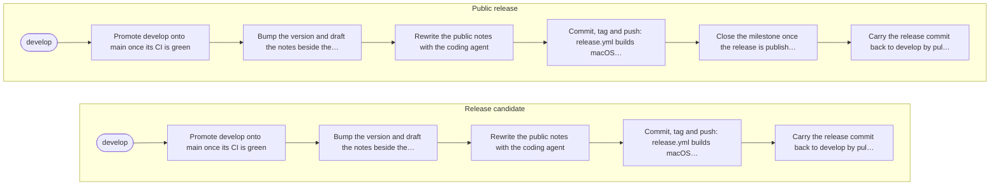

# Release pipeline: MoltenTerm

> Generated by MoltenTerm from `.molten/project.json` with each pipeline setup or update; do not edit it by hand: the next update rewrites it, and shows the difference before writing.

## Overview

- **Kind:** distributed (versions are published)
- **Trunk:** `develop` · **published branch:** `main`: the trunk is promoted onto the published branch, and the tag is made there.
- **Tags:** public `vX.Y.Z`, release candidates `vX.Y.Z-N`.
- **Published to:** DMG image, Linux packages, NSIS installer, MSI installer, GitHub Release.
- **Details** (commands, instructions, CI jobs, version files): `.molten/project.json`.

## Flow diagram

Rounded: the trunk. Slanted: a step done by hand. Hexagon: the tag. Dotted: what the tag starts on GitHub. Cylinder: where versions are published.

## Release candidate flow

| # | Phase | Step | Who | Asks to confirm |
| --- | --- | --- | --- | --- |
| 1 | prepare | Promote develop onto main once its CI is green | MoltenTerm | — |
| 2 | prepare | Bump the version and draft the notes beside the checkout | MoltenTerm | — |
| 3 | cut | Rewrite the public notes with the coding agent | MoltenTerm | — |
| 4 | cut | Commit, tag and push: release.yml builds macOS and Linux and publishes the prerelease | MoltenTerm | {tag} is public once pushed: the release workflow builds it and publishes it as a prerelease. Walk RELEASE.md's checklist on the rehearsal of this commit first, and on the prerelease after. |
| 5 | back | Carry the release commit back to develop by pull request | MoltenTerm | — |

## Public release flow

| # | Phase | Step | Who | Asks to confirm |
| --- | --- | --- | --- | --- |
| 1 | prepare | Promote develop onto main once its CI is green | MoltenTerm | — |
| 2 | prepare | Bump the version and draft the notes beside the checkout | MoltenTerm | — |
| 3 | cut | Rewrite the public notes with the coding agent | MoltenTerm | — |
| 4 | cut | Commit, tag and push: release.yml builds macOS and Linux and leaves a draft release | MoltenTerm | {tag} is public once pushed, and goes to every user once its draft release is published. Walk RELEASE.md's checklist on the draft's files before publishing it. |
| 5 | publish | Close the milestone once the release is published | MoltenTerm | — |
| 6 | back | Carry the release commit back to develop by pull request | MoltenTerm | — |

## Change history

<!-- molten:history -->
| Date | Change | By | Pull request | MoltenTerm template |
| --- | --- | --- | --- | --- |
| 2026-11-02 | Pipeline updated | AGachet | [#1787](https://github.com/DiamondForgeFr/moltenterm/pull/1787) | 2 |
<!-- /molten:history -->
